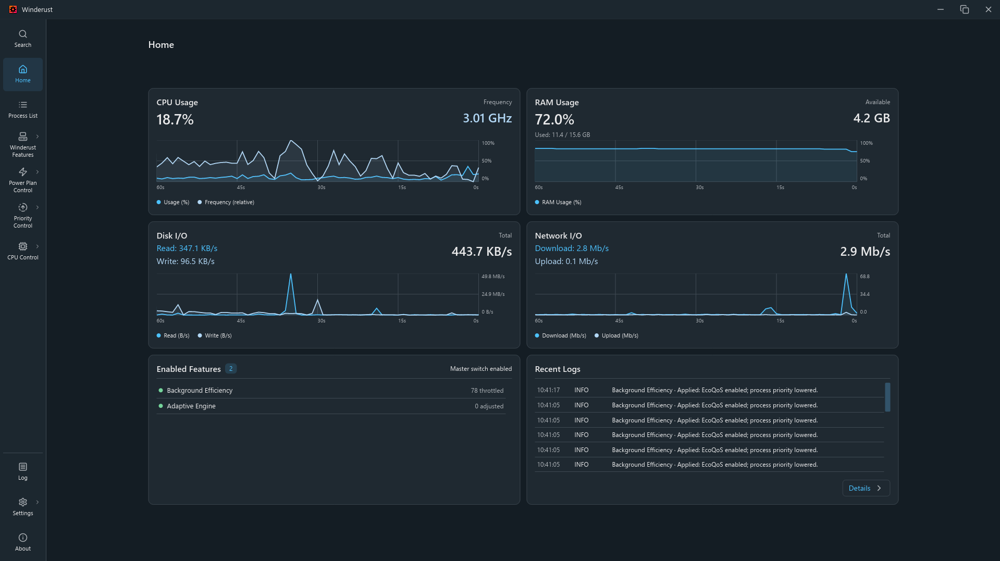

<p align="center">
  
</p>

<h1 align="center">Winderust</h1>

<p align="center">
  <strong>Windows Performance &amp; Power Manager</strong><br>
  An engine to improve your Windows experience.
</p>

<p align="center">Powered by <strong>Rust</strong> and <strong>Iced</strong>.</p>

<p align="center">
  <a href="https://github.com/TatshSiow/Winderust/releases"><strong>Download the latest release</strong></a>
  &nbsp;&middot;&nbsp;
  <a href="#features">Features</a>
  &nbsp;&middot;&nbsp;
  <a href="#runbuild-it-yourself">Build from source</a>
</p>

<p align="center">
  <a href="https://discord.com/invite/M7nctFZUxX">
    
  </a>
</p>

> [!WARNING]
> Alpha state, expects things to break,imperfect or not nicely handled.

<p align="center">
  
</p>

## Features

- Adaptive Engine - automatic background process restraint.
- Background Efficiency - set power-efficiency preferences by app and window state.
- Power Plan Control - switch plans by app focus, running apps, CPU load, activity, or time, with optional restoration when no rule selects a plan.
- Advanced Power Plan Tuning - adjust processor performance, core parking, boost, and thread scheduling policies.
- CPU Control - CPU Limiter, CPU Sets (Soft), Processor Affinity (Hard), and Cache Domain presets.
- Priority Control - Process Priority, Thread Priority, Dynamic Priority Boost, I/O Priority, GPU Priority, and Memory Priority.
- Memory Trim - trim background process working sets.
- Watchdog - CPU and memory alerts for combined usage by path or for individual process instances. Combined rules that match an executable path can also Terminate or Restart apps.
- App Suspension and Timer Resolution for selected apps.
- Sleep Prevention - prevent idle sleep while selected apps run, with an option to keep the display on.
- Keep Running - relaunch selected desktop apps after their last instance exits. Start the app yourself once to arm its rule.
- Instance Limits - monitor process counts and notify when an app exceeds your chosen maximum, without blocking launches.
- Instance Balancing - distribute whole-core CPU Sets (Soft) preferences across app instances.
- Process List and Action Log - inspect running processes and export action history to CSV.
- Win32 Priority Separation - adjust Windows scheduler time slices and foreground boost, with backup and restore.
- Interrupt Timing - capture DPC and ISR activity and export completed reports to JSON.

## Getting started

Download and extract the release ZIP, then run `winderust.exe`. Settings are saved in `settings.toml` beside the executable.

Check the [changelog](CHANGELOG.md) before upgrading; settings formats can change between alpha releases.

## Run/Build it yourself
- [Prerequisites](https://rustup.rs)

Debug build
```powershell
cargo run
```

Release build
```powershell
cargo build --release
```

The release build is in `target\release\winderust.exe`.


## Bug Report

Include your Winderust version, Windows version, and steps to reproduce the problem.

Attach these logs from beside the executable if present:

- `winderust-diagnostics.log`
- `winderust-recovery.log`
- other`*.previous.log` files

Logs may contain process names and local path, review them before upload/reporting.

Using developer **End Task**, system crash or power loss may not generate the log.

## Contributions

Check:
- [CONTRIBUTING.md](CONTRIBUTING.md)
- [SECURITY.md](SECURITY.md)

## License

Copyright (C) 2026 Tatsh Siow.
Licensed under [GPL-3.0-only](LICENSE).
