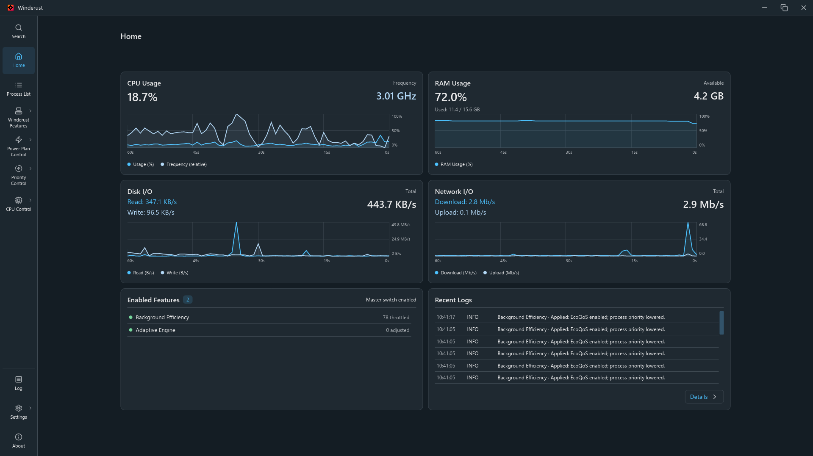

<p align="center">
  
</p>

<h1 align="center">Winderust</h1>

<p align="center">
  <strong>Windows Performance &amp; Power Manager</strong><br>
  An engine to improve your Windows experience.
</p>

<p align="center">Powered by <strong>Rust</strong> and <strong>Iced</strong>.</p>

<p align="center">
  <a href="https://github.com/TatshSiow/Winderust/releases"><strong>Download the latest release</strong></a>
  &nbsp;&middot;&nbsp;
  <a href="#features">Features</a>
  &nbsp;&middot;&nbsp;
  <a href="#runbuild-it-yourself">Build from source</a>
</p>

<p align="center">
  <a href="https://discord.com/invite/M7nctFZUxX">
    
  </a>
</p>

> [!WARNING]
> Alpha state, expects things to break,imperfect or not nicely handled.

<p align="center">
  
</p>

## Features

- Adaptive Engine that automatically adjust background process resources
- Automatic power plan
- CPU/GPU/Memory/IO etc. Priority Controls
- Smart memory trimming for background process
- CPU/Memory watchdog (Alert,Kill,Restart)
- iOS inspired background app suspension
- etc. 

## Run/Build it yourself
- [Prerequisites](https://rustup.rs)

Debug build
```powershell
cargo run
```

Release build
```powershell
cargo build --release
```

The release build is in `target\*`


## Bug Report

When reporting a crash or uncommon behaviour, attach :
- `winderust-diagnostics.log`
- `winderust-recovery.log`
- other`*.previous.log` files

Logs may contain process names and local path, review them before upload/reporting.

Using developer **End Task**, system crash or power loss may not generate the log. 

## Contributions

Check:
- [CONTRIBUTING.md](CONTRIBUTING.md)
- [SECURITY.md](SECURITY.md).

## License

Copyright (C) 2026 Tatsh Siow.
Licensed under [GPLv3](LICENSE).
